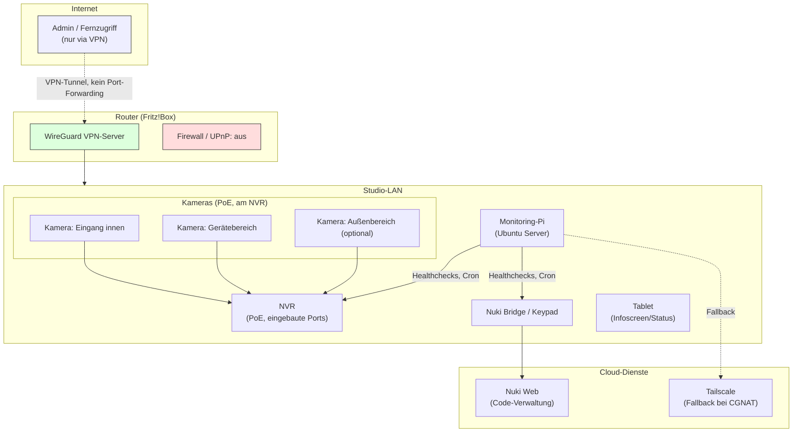

# IHHT Self-Service-Studio — Netzwerk- & Zutrittsinfrastruktur

**Rolle:** Systemintegration / Infrastruktur-Konzeption & Umsetzung
**Kunde:** Wellness-/Gesundheitsstudio (IHHT-Hypoxie-Training), Self-Service-Betrieb ohne durchgehende Mitarbeiterpräsenz
**Zeitraum:** 2026

> Kundenname und alle konkreten Netzwerk-/Zugangsdaten in diesem Repository sind anonymisiert bzw. durch Platzhalter ersetzt. Gezeigt wird ausschließlich die Architektur und die zugrunde liegenden Entscheidungen — keine produktiven Zugangsdaten, IP-Adressen oder Standortdaten.

## Projektkontext

Das Studio funktioniert komplett ohne feste Mitarbeiterpräsenz: Mitglieder öffnen die Tür per persönlichem Zugangscode, nutzen ein freies Trainingsgerät, die Tür verriegelt beim Verlassen automatisch. Meine Aufgabe war die komplette technische Konzeption und Einrichtung der dafür nötigen Infrastruktur. Von der Zutrittskontrolle über die Überwachung bis zum Remote-Monitoring.

## Architektur

**IP-Schema (Platzhalter, reales Schema liegt dem Kunden vor):**

| Gerät | Adresse (Beispiel) | Vergabe |
|---|---|---|
| Router | `192.168.X.1` | fest |
| NVR | `192.168.X.50` | DHCP-Reservierung |
| Monitoring-Pi | `192.168.X.60` | DHCP-Reservierung |
| Nuki Bridge/Keypad | `192.168.X.70` | DHCP-Reservierung |
| Tablet | `192.168.X.80` | DHCP-Reservierung |

## Tech-Stack

| Bereich | Eingesetzte Technik | Warum |
|---|---|---|
| Zutritt | Nuki Smart Lock Pro + Keypad 2 + Door Sensor | Pro-Mitglied-Code statt Sammelcode, zentrale Verwaltung über Nuki Web, Zeitfenster-Steuerung |
| Überwachung | Reolink PoE-Kameras + NVR | Stromversorgung und Datenübertragung über ein Kabel (PoE), zentrale, abschließbare Aufzeichnung |
| Monitoring | Raspberry Pi, Ubuntu Server, Docker, Uptime Kuma | Günstige, stromsparende Dauerüberwachung von Nuki/NVR-Erreichbarkeit, eigenes Bash-Skript per Cron für Systemchecks |
| Fernzugriff | WireGuard (Fritz!Box), Tailscale als Fallback | Kein Port-Forwarding – VPN-only reduziert die Angriffsfläche drastisch gegenüber offenen Ports |

## Sicherheits- und Datenschutzentscheidungen

Diese Entscheidungen waren mir besonders wichtig und sind bewusst getroffen, nicht nur "Standardkonfiguration":

- **Kein Sammelcode.** Jedes Mitglied bekommt einen eigenen Nuki-Code, persönlich übergeben beim Erstbesuch — nachvollziehbar, wer wann Zutritt hatte, und einzeln sperrbar bei Problemen.
- **Kein Port-Forwarding, niemals.** Jeglicher Fernzugriff läuft ausschließlich über VPN (WireGuard primär, Tailscale als Fallback bei CGNAT/DS-Lite). UPnP ist am Router deaktiviert.
- **Kameras ohne Audio, kurze Speicherfrist, keine Kameras in sensiblen Bereichen** (WC/Umkleide). Hinweisschild vor dem Betreten, wie gesetzlich für die Videoüberwachung vorgesehen.
- **Rollengetrenntes NVR-Zugriffskonto**: Das Betreiber-Team bekommt ein eingeschränktes Konto, Admin-Zugriff bleibt bei mir.
- **2-Faktor-Authentifizierung** auf allen Cloud-Konten (Nuki, Reolink), alle Zugangsdaten in einem Passwort-Tresor (KeePassXC).
- **Getrennte Wartungsfenster**: Fritz!Box-Firmware automatisch, NVR-Firmware bewusst manuell (um unerwartete Ausfälle während des laufenden Self-Service-Betriebs zu vermeiden).

## Was hier bewusst NICHT drin ist

- Reale IP-Adressen, Zugangscodes, Passwörter oder Kontodaten
- Exakte Kamerapositionen/-winkel oder Grundrisse
- Der Name des Kunden/Studios

Diese Trennung ist Absicht: Das Repository zeigt die Architektur und Entscheidungen, nicht die produktiven Betriebsdaten eines laufenden Kundensystems.
